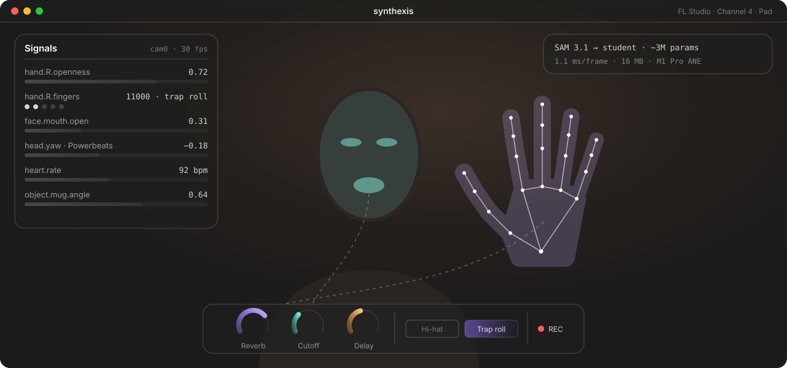
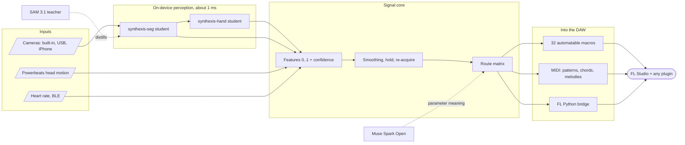
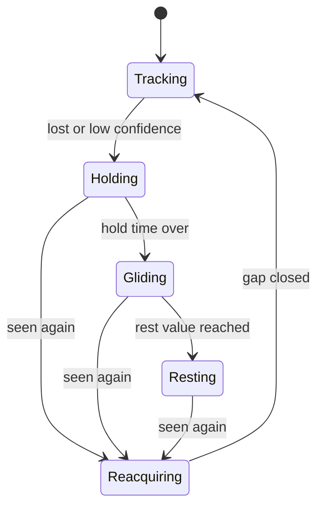
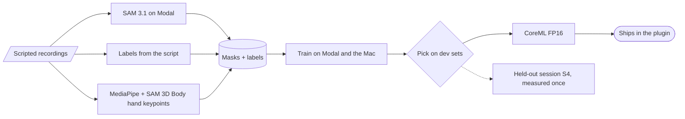

  

# synthexis

Hands, face, headphones and everyday objects as a playable control layer for the plugins producers already own.

synthexis is an audio plugin (VST3, CLAP, later AU; Apple Silicon) for FL Studio. It watches one or more cameras, reads head motion and heart rate from Powerbeats Pro 2, and turns what it sees into automation and MIDI: open your fist and the reverb on your pad blooms, raise thumb and index finger and the hi-hat switches to a trap roll, turn your head and the delay sweeps. It has no synth of its own. It plays the instruments and effects already in your project, and FL Studio records every move.

> Built for the **Meta Global AI Developer Hackathon** (Oct 26 to Nov 4, 2026), Indie track, theme "Build for Your World". Everything in this repository was created during the event; the commit history starts on Oct 26. One asset is older: the mapping parser's encoder (see [Carried over from earlier work](#carried-over-from-earlier-work)).

## Why Meta models

Live segmentation with SAM 3.1 from a plugin would cost $21.60 per hour per camera (30 fps x 3600 s x $0.20 per 1000 frames) plus a network round trip on every frame. synthexis distills SAM 3.1 into a student model of about 3M parameters that runs on the laptop's Neural Engine every frame, for free.

| Meta model | Where | What it does in synthexis |
|---|---|---|
| SAM 3.1 (open weights) | Modal GPUs | Teacher: pixel masks for hands, face, eyes, mouth, body and objects on our recordings |
| SAM 3.1 (Meta Model API) | in the plugin | Snapshot cut-outs that stay on the canvas as playable elements; cross-check of the teacher labels |
| Muse Spark Open | Baseten | Labels what every plugin parameter means (cutoff, reverb mix, attack ...); runs the mapping agent |
| Muse Image | Meta Model API | Renders diverse people, hands and rooms so the student does not only know one face |
| Muse Glimmer 30B | Fireworks | Second labeler: a label survives only if Glimmer and Spark Open agree |
| Muse Voice Transcribe | Meta Model API | Optional: say the mapping instead of typing it |

## How it works

Every input speaks one contract: a value from 0 to 1, a confidence and the capture time. Every feature reuses the same conditioning chain, so new sources (a second camera, a sensor) plug in without new special cases. Perception never runs on the audio thread; the audio thread reads the latest values from a lock-free snapshot once per block.

When a feature disappears (you turn your head and the camera loses your mouth), the value holds instead of snapping to zero, then glides back without a jump when the feature returns:

### The student models

The recordings follow a script ([recording protocol](docs/recording-protocol.md)): each segment shows one known finger state, face action or object, so gesture labels come from the script and cannot be invented by a model. SAM 3.1 adds the masks. Three students came out of it: seg, hand (keypoints, finger states, left or right) and face. None passed the held-out quality gate except the mouth; the plugin uses seg and hand, and takes the face from Apple Vision landmarks ([results](probes/train-students/RESULT.md)).

## Measured so far

All on an M1 Pro (16 GB, macOS 27) or real Modal GPUs. Raw logs and exact commands are in each probe folder.

| What | Result | Source |
|---|---|---|
| SAM 3.1 on Modal, H100 | 46.8 ms per video frame, 59.6 ms per image; $0.051 per 1000 frames (API: $0.20) | [probes/sam31-modal](probes/sam31-modal/RESULT.md) |
| Student candidates on the Neural Engine | 0.35 to 0.74 ms per inference at 1.5M to 3.2M parameters | [probes/coreml-student-latency](probes/coreml-student-latency/RESULT.md) |
| Full frame: seg + two hand crops | 1.12 ms median, 2.06 ms p95, +16 MB memory | [probes/coreml-student-latency](probes/coreml-student-latency/RESULT.md) |
| Trained students on the Neural Engine | p95 per call: seg 0.65 ms, hand 0.66 ms per crop, face 0.50 ms | [probes/train-students](probes/train-students/RESULT.md) |
| Trained students on the held-out session S4 | seg IoU person / face / hand 0.77 / 0.80 / 0.80 (gate 0.85); finger states 0.89 (0.95); left/right 0.94; face mouth 0.71 (0.70), eye 0.24 | [probes/train-students](probes/train-students/RESULT.md) |
| Apple Vision for comparison | 18.4 ms hand pose, 29.6 ms hand + face + body | [probes/apple-vision-fps](probes/apple-vision-fps/RESULT.md) |
| Camera inside a Rust plugin (standalone, night light) | works; 18.6 fps, about 100 ms capture latency, light-bound | [probes/fl-camera-plugin](probes/fl-camera-plugin/RESULT.md) |

The two candidate rows use untrained weights; latency does not depend on weight values. The [hill-climb log](docs/hillclimb.md) tracks every change against these baselines.

## Status

- [x] Plan, feature inventory and decisions: [`spec/synthexis.yaml`](spec/synthexis.yaml), [`docs/plan.md`](docs/plan.md)
- [x] Feasibility probes: SAM 3.1 on Modal, student latency, Apple Vision baseline, camera in a Rust plugin
- [ ] Hardware probes in FL Studio: automation recording, MIDI out, FL Python bridge, Powerbeats motion and heart rate
- [x] Recordings and teacher labels: four sessions, 47,367 frames
- [x] Students v1 and eval gate: trained and in the plugin; the gate passes for the mouth only
- [ ] Plugin: camera, signals, macros, gestures and MIDI, snapshot anchors, mapping agent
- [ ] Demo video (3 min)

Planning board with all diagrams: [FigJam](https://www.figma.com/board/WJIE59w34hCSTXuq3XpKGH).

## Platforms

synthexis runs on macOS with Apple Silicon. Perception uses CoreML on the Neural Engine for the three students in [`plugin/models/`](plugin/models/README.md) and Apple Vision for face landmarks. Without Apple Vision, the face student takes over (mouth works; its eye signal is weak). A Windows or Linux port would swap two parts and keep the pipeline:

| part | macOS today | Windows / Linux candidate |
|---|---|---|
| student models (seg, hand, face) | CoreML FP16 on the Neural Engine | the same weights exported to ONNX, run with ONNX Runtime through the Rust crate [`ort`](https://docs.rs/ort): DirectML on Windows; CPU, CUDA or OpenVINO on Linux (built from source) |
| face landmarks (eyes, mouth, smile, head pose) | Apple Vision | [MediaPipe Face Landmarker](https://developers.google.com/edge/mediapipe/solutions/vision/face_landmarker/index): 478 points and 52 blendshapes such as `eyeBlinkLeft` and `jawOpen`; licence of the model bundle still to check |
| hand keypoints (optional second source) | hand student | MediaPipe Hand Landmarker (Apache 2.0, already the keypoint teacher of the hand student) |

None of this is built yet.

## Repository

| Path | Content |
|---|---|
| `spec/` | single source of truth: features, signals, decisions, recording script |
| `docs/` | plan, judging fit, recording protocol, hill-climb protocol, credit texts |
| `probes/` | feasibility probes, each with code, `RESULT.md` and raw logs |
| `tools/` | generators (recording script) |
| `plugin/models/` | the three trained perception students (CoreML), with their licence notice |
| `LICENSES/` | licence texts of the models and weights the project builds on |

## Privacy

Recordings of faces and hands stay on the machine and in a private Modal volume used for labeling. `data/` is git-ignored; no recording or dataset is ever committed. The trained student weights are published; they hold model parameters only, not images.

## Carried over from earlier work

The one thing synthexis takes from before Oct 26 is a weight file, not code: the encoder of the mapping parser. It is mmBERT small (`jhu-clsp/mmBERT-small` at `abc32620`, MIT, Marone et al. 2025) with its 256,000-token vocabulary trimmed to the 32,769 tokens German and English need. Noa made that trim on 2026-09-28 in kleinhirn, his earlier project on small encoder classifiers in the browser, where the trimmed vocabulary still covered 94.5 % of the tokens in a German and English web sample and the embedding table shrank from 256,000 to 32,769 rows. Here it proved its worth again: as the parser's encoder it raised exact match on Noa's hand-written sentences from 22 % to 31 % over the from-scratch encoder (parser v7). The trim script stays in kleinhirn and was not copied; the parser, its decoder, training and runtime are new code in this repository.

## License

Source code: [MIT](LICENSE). VST3 builds made with nih-plug's VST3 wrapper link GPLv3 bindings, so those binaries are distributed under GPLv3. SAM 3.1 is used under the SAM License; Muse Glimmer under Apache 2.0; the mmBERT encoder under MIT; the MobileNetV4 and MobileNetV3 backbones from timm under Apache 2.0.

The trained perception students in [`plugin/models/`](plugin/models/README.md) are released with the code. They build on timm backbones (Apache 2.0) and learned from SAM 3.1 and SAM 3D Body (SAM License; DINOv3 License for SAM 3D Body's backbone code) and MediaPipe Hand Landmarker (Apache 2.0), so those terms apply to the weights; the texts are in [`LICENSES/`](LICENSES). This project uses SAM 3.1, SAM 3D Body and DINOv3 by Meta. Required attributions: [docs/credits.md](docs/credits.md); licence review: [probes/licence-check](probes/licence-check/RESULT.md).

Built with Muse Spark Open: the parameter labels and the mapping models are trained on Muse Spark Open outputs under the Muse Model License.
