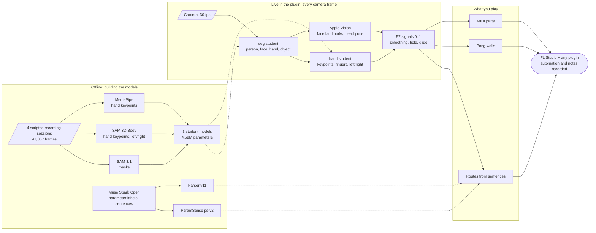
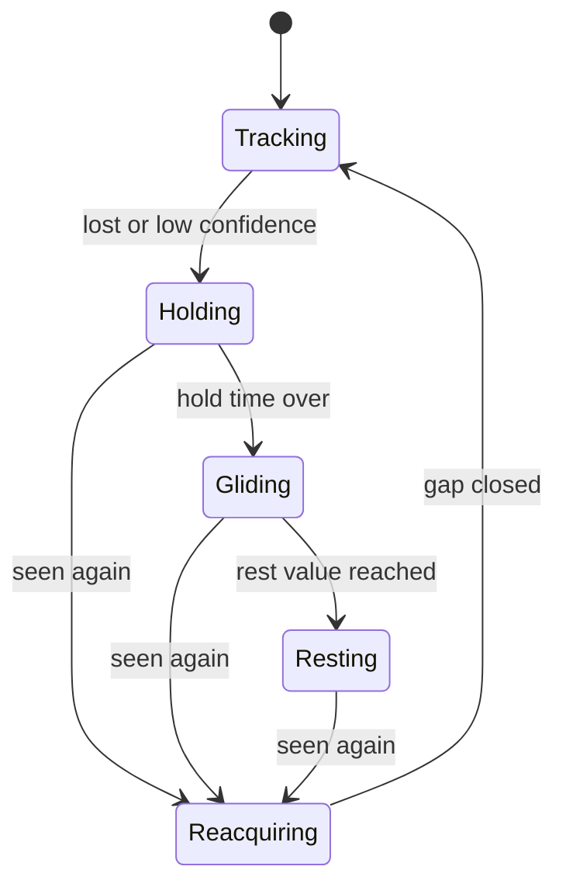
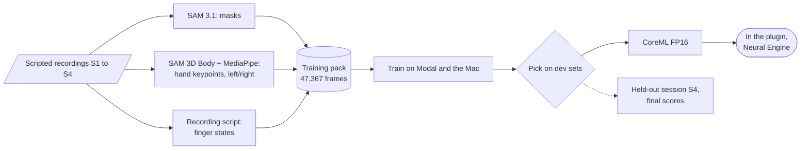
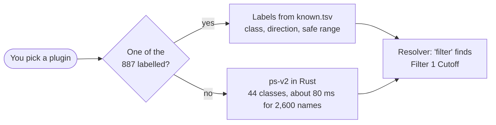
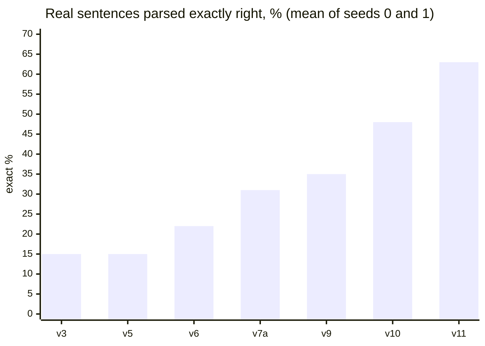

  

The standalone window as of Nov 4, Pong section open, profiles 1 2 3 in the top bar. The camera shows the built-in stand-in picture that the UI test states draw instead of a real face.

# synthexis

Hands, fingers, face and head as a playable control layer for the plugins producers already own.

synthexis is an audio plugin (VST3 and CLAP, Apple Silicon) for FL Studio. It watches the camera and turns what it sees into automation and MIDI: open your fist and the reverb on your pad blooms, show two fingers and the hi-hat switches to a trap roll, open your mouth and the filter opens, point your finger and a projectile bounces off a wall that plays a chord. It has no synth of its own. It plays the instruments and effects already in your project, and FL Studio records every move.

You set it up in plain English or German: type "when I spread my fingers, open the filter" and a route appears. synthexis can read the parameters of any plugin you load.

> [!NOTE]
> Built for the **Meta Global AI Developer Hackathon** (Oct 26 to Nov 4, 2026), Indie track, theme "Build for Your World". Everything in this repository was created during the event; the commit history starts on Oct 26. One asset is older: the mapping parser's encoder (see [Carried over from earlier work](#carried-over-from-earlier-work)).

## Download

> [!TIP]
> **[synthexis for macOS (VST3 and CLAP)](https://github.com/smashburger-dev/synthexis/releases/latest)**: Apple Silicon, FL Studio. Quit FL Studio, unzip, double-click `install.command` (if macOS blocks it: right-click, Open). It installs the plug-ins, the camera models and the FL Studio device script, and downloads the sentence parser once (about 450 MB). Then add synthexis in FL Studio and allow camera access.

The plug-ins are signed ad hoc, not notarized by Apple; the installer clears the download flag so FL Studio can load them. To build from source instead, see [plugin/README.md](plugin/README.md).

## What you can play

The camera gives synthexis 57 live signals, each a value from 0 to 1 with a confidence. The list is `perception_ids()` in [`plugin/synthexis/src/signal.rs`](plugin/synthexis/src/signal.rs).

| Source | Signals | Count |
|---|---|---:|
| Each hand | openness, fist, extension of thumb, index, middle, ring and pinky, tilt of each of the five fingers, spread, x, y, depth (z), pinch, speed, roll, finger count, finger shape | 21 × 2 = 42 |
| Both hands | distance between the hands | 1 |
| Face and head | mouth open, smile, left eye open, right eye open, left eye closed, right eye closed, head turn (yaw), nod (pitch), tilt (roll) | 9 |
| Object | the largest object in view: x, y, size, angle, speed | 5 |
| **Total** | | **57** |

Finger shape is a 5-bit mask, one bit per finger, so each hand can show 2⁵ = 32 finger states. Twelve of them have names (fist, open, point, peace, rock, shaka and six more in [`tools/mapping/ontology.yaml`](tools/mapping/ontology.yaml)), and the hand student was trained on exactly those twelve.

On the other side sit the parameters. synthexis ships labels for **887 plugins with 107,350 parameters** (median 28 per plugin) in [`known.tsv`](plugin/assistant/completion/known.tsv). Every other plugin is read when you pick it: ParamSense classifies its parameter names inside the plugin. Our harvest read 886 Audio Units with 122,664 parameters and 405 VST3 plugins with 716,228 ([mapping pipeline](probes/mapping-pipeline/RESULT.md)).

One route connects one signal to one parameter. Counting single routes only:

| Plugin | Parameters | Single routes (57 signals × parameters) |
|---|---:|---:|
| a typical plugin (median of the 887) | 28 | 1,596 |
| FabFilter Pro-Q 3 | 517 | 29,469 |
| Xfer Serum 2 | 2,622 | 149,454 |
| all 887 labelled plugins | 107,350 | 6,118,950 |

Routes stack: three routes ran at once with both hands in FL Studio on Nov 3. On top of the routes:

- **Pong.** Point your index finger and a projectile flies from the fingertip across the camera frame. Each of the 4 walls plays a MIDI part or moves a parameter of any plugin in FL, or one of 32 Signal macros, in one of 3 modes (Ramp, Position, Toggle). With Serum 2 that is 3 × (2,622 + 32) = 7,962 settings per wall.
- **MIDI parts.** A part is a clip (1 to 8 bars of 16 steps), chords in the key, or a single note. It plays in 3 modes (Gate, Latch, Once) and starts on 4 grids (now, 1/16, beat, bar), so 3 kinds × 3 modes × 4 starts give 36 ways to play a part, in 9 scales × 12 roots = 108 keys, from 6 templates or the piano roll. A part starts on any finger shape, one raised finger, or any signal crossing 0.55.
- **32 Signal macros** that FL can link to anything it automates.

Where each count comes from

| Number | Source |
|---|---|
| 57 signals, 21 per hand, 9 face and head, 5 object | `plugin/synthexis/src/signal.rs` (`HAND_FEATS`, `FACE_IDS`, `OBJECT_IDS`, `perception_ids`) |
| 12 named shapes | `tools/mapping/ontology.yaml` (`shapes`); the same 12 masks in `probes/train-packer/RESULT.md` |
| 887 plugins, 107,350 parameters, median 28 | computed from `plugin/assistant/completion/known.tsv` (plugin header lines and parameter lines) |
| Serum 2: 2,622, Pro-Q 3: 517 | `plugin/assistant/completion/plugins/xfer-records-serum-2.json`, `fabfilter-pro-q-3.json` |
| harvest 886 AU / 122,664, 405 VST3 / 716,228 | `probes/mapping-pipeline/RESULT.md` |
| 4 walls, 3 modes, MIDI part, Signal macro | `plugin/synthexis/src/pong/arena.rs`, `pong/setup.rs` |
| 32 Signal macros | `plugin/synthexis/src/params.rs` |
| clip, chords, note; Gate, Latch, Once; 4 starts; 9 scales; 6 templates | `plugin/synthexis/src/midi.rs` |
| trigger above 0.55, off below 0.45, finger shape | `plugin/synthexis/src/route.rs` (`Trigger`) |
| three routes at once in FL | `docs/roadmap.md` |

The products are plain multiplication of those counts.

## Built with three Meta models

We used SAM 3.1, SAM 3D Body and Muse Spark Open to build our own training data and labels. With them we trained small student models that run inside the plugin on the Mac's Neural Engine. The three Meta models made the labels; none of them runs while you play.

| Meta model | Ran on | What we used it for |
|---|---|---|
| **SAM 3.1** (open weights, `facebook/sam3.1`) | Modal, H100 | Pixel masks for every recorded frame in 7 classes (background, person, face, eye, mouth, hand, object): 47,367 frames over four scripted sessions. The seg and face students learned from these masks, and the hand and face crops are cut from them. |
| **SAM 3D Body** (`facebook/sam-3d-body-dinov3`) | Modal, A10G | 3D hand keypoints wherever MediaPipe missed the hand: fists, hands behind objects, hands holding things. It filled 2,349 of the 38,004 teacher hands and gave the left/right labels for the hand student (99.7 to 100 % against the recording protocol). |
| **Muse Spark Open** | Baseten | Labelled what every plugin parameter means: a class from a 44-class taxonomy, a direction and a safe range. That is the training data of ParamSense: 885 Audio Units and 405 VST3 plugins, 302 + 161 of them labelled twice and adjudicated (85.5 % and 84.3 % agreement). It also wrote the first parser training sentences (stage 1: 8,000 edits, stage 2: 8,374), the English and German glossary (11,333 phrases for 416 concepts) and a QA pass over the recording timelines. |

> [!IMPORTANT]
> Muse Spark Open labelled parameters and language, not pixels. The perception students learned from SAM 3.1, SAM 3D Body, MediaPipe Hand Landmarker (Google, Apache 2.0) and the recording script ([`plugin/models/README.md`](plugin/models/README.md)). Apple Vision output never trains anything; Apple's terms forbid it ([licence check](probes/licence-check/RESULT.md)).

## How it works

The live path in the default `hybrid` mode: the seg student finds person, face, hands and objects; the hand student reads keypoints, the five fingers and which hand it is; Apple Vision reads face landmarks inside the face box the seg student found, which gives mouth, eyes, smile and head angles. Where Apple Vision is not available, the face student covers the face (its mouth works, its eye signal is weak). A `vision` mode that runs hands and face on Apple Vision alone stays as a fallback.

Every signal speaks one contract: a value from 0 to 1, a confidence and the capture time. Perception never runs on the audio thread; the audio thread reads the latest values from a lock-free snapshot once per block. Parameter changes go to FL through its Python bridge script and FL records them as automation; notes go to the FL channel each part names, with no MIDI settings.

When a feature disappears (you turn away and the camera loses your mouth), the value holds instead of snapping to zero, then glides back without a jump when the feature returns:

### The student models

The recordings follow a script ([recording protocol](docs/recording-protocol.md)): each segment shows one known finger state, face action or object, so the finger labels come from the script and no model can invent them. Three students came out of it ([`plugin/models/`](plugin/models/README.md), [results](probes/train-students/RESULT.md)):

| Student | Backbone, size | Held-out session S4 | Neural Engine, median / p95 |
|---|---|---|---|
| seg | MobileNetV4-Conv-Small + LR-ASPP, 1.51M, 384×216 plus the previous mask | IoU person 0.766, face 0.798, hand 0.797 | 0.547 / 0.649 ms |
| hand | MobileNetV3-Small, 1.57M, 128 px crop | five finger states exact 0.890; left/right 0.941 | 0.400 / 0.657 ms per crop |
| face | MobileNetV4-Conv-Small + LR-ASPP, 1.51M, 128 px crop | mouth IoU 0.705, eye 0.243 | 0.339 / 0.500 ms |

Seg, two hand crops and the face together take about 1.6 ms median and 2.2 ms p95 of model time. S4 was kept out of training, but several model choices looked at it before the dev-only rule of Nov 3, so the S4 figures are partly optimistic (listed in the [results](probes/train-students/RESULT.md)).

> [!NOTE]
> The quality gates are strict (IoU 0.85, finger states 0.95). Only the face student's mouth passed (0.705 against 0.70). In the plugin, the finger reading averages the student with keypoint geometry: 0.895 of five-finger states exact on S4 ([finger shapes](probes/finger-shapes/RESULT.md)). A 20 s calibration per person comes on top of that.

### ParamSense: every plugin can be read

Muse Spark Open labelled 41,656 parameter lines across those runs (computed from the four runs in [mapping pipeline](probes/mapping-pipeline/RESULT.md)); duplicates and rules spread them to the 107,350 parameters in `known.tsv`. ps-v2 learned from those labels: an ensemble of five nets folded into one, 16.1M parameters, 32 MB, top-1 76.2 % and macro F1 58.3 on plugins from 19 vendors it never saw ([ParamSense v2](probes/paramsense-v2/RESULT.md)). Its Rust port matches Python on 2,426 names.

### The parser: from a sentence to routes

The sentence field runs a parser trained for this job: an mmBERT-small encoder, four seeds as one ensemble in 8-bit weights (277 MB), 75 ms median and 135 ms p95 per sentence in Rust. It learned from eight stages of synthetic sentences: Muse Spark Open wrote the first ones, DeepSeek V4.1 Flash stages 6 to 8 ([`docs/roadmap.md`](docs/roadmap.md)). We measured each version on real sentences built from 34 that Noa wrote himself, kept out of the training data:

The shipped v11 ensemble gets 66 of 102 exact (65 %) and 89 of 102 right or one part off (87 %). Muse Spark Open parsing the same set directly reached 62 of 99 (63 %). While you type, an 8-item completion list and ghost text suggest gestures and parameters. A simulated user who picks them raises route_edit on the synthetic dev sets from 0.776 to 0.802 ([completion](probes/completion-v11/RESULT.md)).

What moved each step

| Version | Lever | Exact, mean of seeds 0 and 1 |
|---|---|---:|
| v3 | targeted stage 3 sentences (several routes, modifiers) | 15 / 99 |
| v5 | stage 4 sentences | 15 / 99 |
| v6 | sentences in the style of the real ones (stage 5) | 21.5 / 99 |
| v7a | mmBERT-small encoder instead of training from scratch | 31 / 99 |
| v9 | Noa's label conventions, stage 6 | 36 / 102 |
| v10 | each movement said in its low direction, stage 7 | 49 / 102 |
| v11 | four data gaps closed, stage 8 | 64 / 102 |

Seed counts from [`probes/real-eval/RESULT.md`](probes/real-eval/RESULT.md); the set grew from 99 to 102 rows at v9. Over four seeds v11 gains +14.7 points on v10 (p < 0.0001).

## Measured so far

All on an M1 Pro (16 GB, macOS 27) or Modal GPUs. Raw logs and exact commands are in each probe folder. S4 is the held-out recording session; some earlier choices looked at it, so S4 numbers are partly optimistic (each RESULT.md lists which).

| What | Result | Source |
|---|---|---|
| Perception in the plugin, `hybrid`, S4 (7,977 frames) | hands out after 2.9 ms median / 4.2 ms p95, face after 8.0 ms median; budget 5 ms p95 | [plugin-perception](probes/plugin-perception/RESULT.md) |
| Apple Vision alone (`vision` mode), same frames | 21.16 / 28.74 ms (a second run: 31.0 / 39.4 ms) | [plugin-perception](probes/plugin-perception/RESULT.md) |
| Camera to FL parameter, live in FL | latest run, 25 windows: median 55 to 145 ms, p95 76 to 155 ms; first `hybrid` run: p95 120 to 148 ms against 157 to 212 ms for `vision`, all 30 fps kept | [plugin-perception](probes/plugin-perception/RESULT.md) |
| Hand on the correct side, S4 | 98.7 % (wrong side 0.2 %); Apple Vision 99.0 % | [plugin-perception](probes/plugin-perception/RESULT.md) |
| Finger states in the plugin, S4 | five fingers exact 0.895 (student plus geometry, without the per-person calibration); per finger 0.925 | [finger-shapes](probes/finger-shapes/RESULT.md), [plugin-perception](probes/plugin-perception/RESULT.md) |
| Students on the Neural Engine | seg 0.547, hand 0.400 per crop, face 0.339 ms median; seg, two hand crops and face about 1.6 ms | [train-students](probes/train-students/RESULT.md) |
| SAM 3.1 on Modal, H100, real weights | 58 ms median per text prompt | [sam31-modal](probes/sam31-modal/RESULT.md) |
| Face and head rules (mouth, eyes, head angles) | 37 / 33 / 36 / 37 of 43 pass on S1 to S4 (34 / 31 / 33 / 30 before the head pose fit) | [head session](docs/session-2026-11-04-head.md) |
| Pong shot | point and hold 100 ms (Noa's pick in FL): fires in 5 of 6 index segments on S2 and S3, 2.7 false shots per minute (300 ms: 1.5) | [pong-shot](probes/pong-shot/RESULT.md) |
| MIDI notes into FL | 16 of 16 recorded, delivery p95 0.42 ms, 600 notes in 20 s | [fl-midi-notes](probes/fl-midi-notes/RESULT.md) |
| Parser in Rust | 75 ms median, 135 ms p95, 805 of 805 dev frames equal to Python | [roadmap](docs/roadmap.md) |
| ParamSense ps-v2 | top-1 76.2 %, macro F1 58.3 on 19 unseen vendors | [paramsense-v2](probes/paramsense-v2/RESULT.md) |

The [hill-climb log](docs/hillclimb.md) tracks every change against these baselines.

## Status

Nov 4, 2026.

**Built and tested in FL Studio**

- [x] Camera in the plugin, `hybrid` perception by default, 30 fps without drops
- [x] Hand routes from sentences, three at once with both hands, recorded as automation
- [x] Fist-to-open calibration and the two-hand x split (each hand on its side of the face)
- [x] Plugin picker follows the plugin FL has in focus; the bridge links itself, no MIDI settings
- [x] MIDI notes through the bridge into the channel each part names

**Built, FL test in progress**

- [x] MIDI parts with finger triggers, templates, piano roll and finger calibration
- [x] Pong: point to shoot, four walls with MIDI parts, parameters or Signal macros
- [x] Presets with the sections Hands, Pong and Head
- [x] Head section: mouth, each eye, head turn, nod and tilt; clickable line head
- [x] Parser v11 and completion in Rust, ParamSense in the plugin
- [x] New UI: camera on top, plugin picker, sentence field, preset picker, dithered backdrop
- [x] Profiles 1 / 2 / 3 in the top bar: each holds the whole setup, saved with the project
- [x] Chat routes shown on the hands and the head, editable in the routes view with type-to-search

**Open**

- [ ] Orb, recording latency compensation, the shot as a bindable movement
- [x] Download release for macOS (VST3 and CLAP, ad-hoc signed)
- [ ] Notarized release, Windows

Planning board with every diagram: [FigJam](https://www.figma.com/board/WJIE59w34hCSTXuq3XpKGH).

More screenshots

  

Head section with a mouth route to Serum 2 and the face boxes over the camera.

  

Hands section: click a finger to give it a MIDI part.

## Platforms

synthexis runs on macOS with Apple Silicon. Perception uses CoreML on the Neural Engine for the three students in [`plugin/models/`](plugin/models/README.md) and Apple Vision for face landmarks. Without Apple Vision, the face student takes over (mouth works; its eye signal is weak). A Windows or Linux port would swap two parts and keep the pipeline:

| part | macOS today | Windows / Linux candidate |
|---|---|---|
| student models (seg, hand, face) | CoreML FP16 on the Neural Engine | the same weights exported to ONNX, run with ONNX Runtime through the Rust crate [`ort`](https://docs.rs/ort): DirectML on Windows; CPU, CUDA or OpenVINO on Linux (built from source) |
| face landmarks (eyes, mouth, smile, head pose) | Apple Vision | [MediaPipe Face Landmarker](https://developers.google.com/edge/mediapipe/solutions/vision/face_landmarker/index): 478 points and 52 blendshapes such as `eyeBlinkLeft` and `jawOpen`; licence of the model bundle still to check |
| hand keypoints (optional second source) | hand student | MediaPipe Hand Landmarker (Apache 2.0, already the keypoint teacher of the hand student) |

None of this is built yet.

## Repository

| Path | Content |
|---|---|
| `plugin/` | the plugin in Rust: engine, UI, parser runtime, completion, FL bridge script |
| `plugin/models/` | the three trained perception students (CoreML), with their licence notice |
| `plugin/assistant/` | parameter labels, completion data, parser release |
| `spec/` | single source of truth: features, signals, decisions, recording script |
| `docs/` | roadmap, plan, session digests, recording and hill-climb protocols, credit texts |
| `probes/` | measurements, each with code, `RESULT.md` and raw logs |
| `tools/` | data tools: recording script, parameter harvest and labelling, ontology |
| `LICENSES/` | licence texts of the models and weights the project builds on |

## Privacy

Recordings of faces and hands stay on the machine and in a private Modal volume used for labelling. `data/` is git-ignored; no recording or dataset is ever committed. The trained student weights are published; they hold model parameters only, not images. In the plugin, every camera frame is processed on the Mac and never leaves it.

## Carried over from earlier work

The one thing synthexis takes from before Oct 26 is a weight file, not code: the encoder of the mapping parser. It is mmBERT small (`jhu-clsp/mmBERT-small` at `abc32620`, MIT, Marone et al. 2025) with its 256,000-token vocabulary trimmed to the 32,769 tokens German and English need. Noa made that trim on 2026-09-28 in kleinhirn, his earlier project on small encoder classifiers in the browser, where the trimmed vocabulary still covered 94.5 % of the tokens in a German and English web sample and the embedding table shrank from 256,000 to 32,769 rows. Here it proved its worth again: as the parser's encoder it raised exact match on Noa's hand-written sentences from 22 % to 31 % over the from-scratch encoder (parser v7). The trim script stays in kleinhirn and was not copied; the parser, its decoder, training and runtime are new code in this repository.

## License

Source code: [MIT](LICENSE). VST3 builds made with nih-plug's VST3 wrapper link GPLv3 bindings, so those binaries are distributed under GPLv3. SAM 3.1 and SAM 3D Body are used under the SAM License; the mmBERT encoder under MIT; the MobileNetV4 and MobileNetV3 backbones from timm under Apache 2.0.

The trained perception students in [`plugin/models/`](plugin/models/README.md) are released with the code. They build on timm backbones (Apache 2.0) and learned from SAM 3.1 and SAM 3D Body (SAM License; DINOv3 License for SAM 3D Body's backbone code) and MediaPipe Hand Landmarker (Apache 2.0), so those terms apply to the weights; the texts are in [`LICENSES/`](LICENSES). This project uses SAM 3.1, SAM 3D Body and DINOv3 by Meta. Required attributions: [docs/credits.md](docs/credits.md); licence review: [probes/licence-check](probes/licence-check/RESULT.md).

Built with Muse Spark Open: the parameter labels and the mapping models are trained on Muse Spark Open outputs under the Muse Model License.
