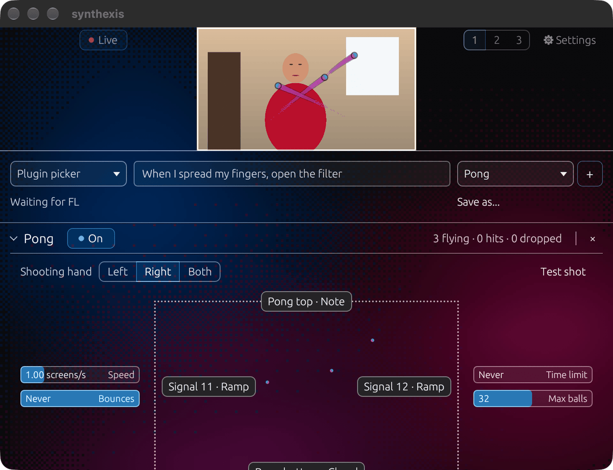
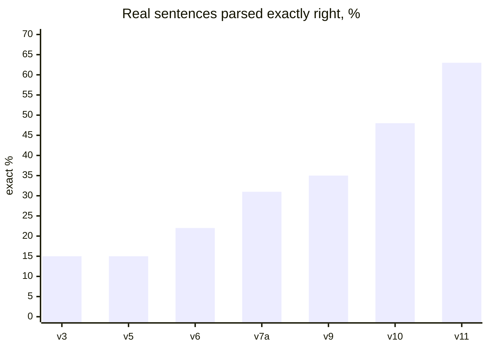
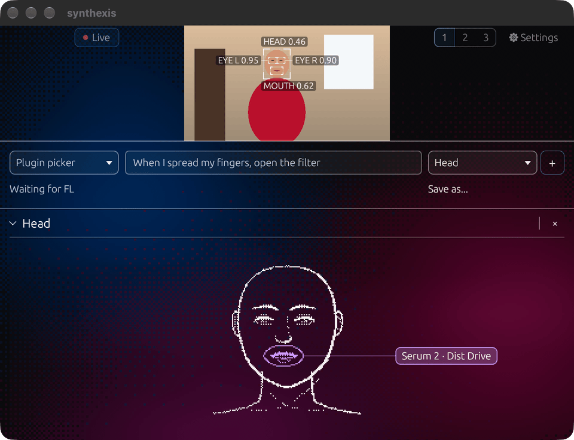
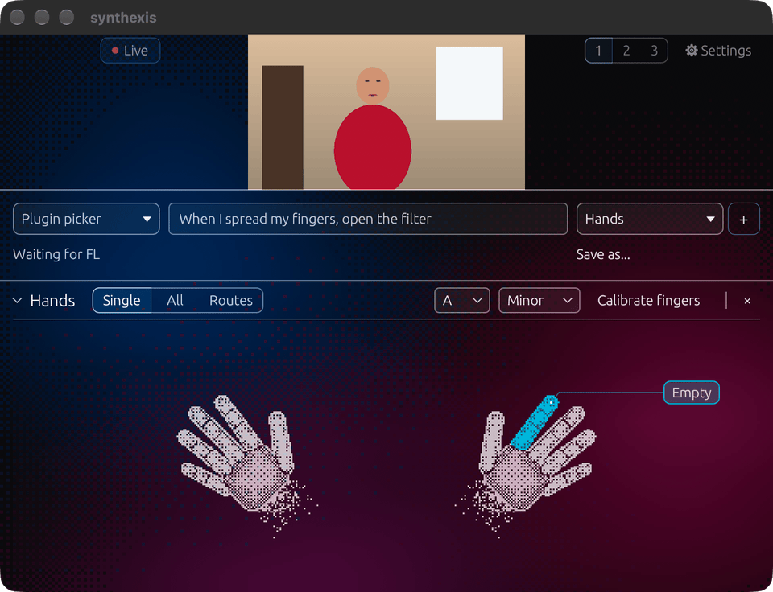

<h1 align="center">synthexis</h1>

<b>Play the plugins you already own with your hands, fingers, face and head.</b>

  
  <!-- demo video badge goes here once the YouTube link is in:
   -->

  
  
  
  
  

> [!IMPORTANT]
> 🏆 **synthexis won Best Creative Build at the Meta Global AI Developer Hackathon 2026.**
> Built in ten days, Oct 26 to Nov 4, 2026, in the Indie track under the theme "Build for Your World". The commit history starts on Oct 26.

  

Serum 2 has 2,622 parameters, and you reach them one at a time with a mouse. synthexis turns the camera into the controller. Open your fist and the reverb on your pad blooms. Show two fingers and the hi-hat switches to a trap roll. Open your mouth and the filter opens. Point your finger and a projectile bounces off a wall that plays a chord.

synthexis has no synth of its own. It plays the instruments and effects already in your project, and FL Studio records every move as automation. You set it up in plain English or German: type "when I spread my fingers, open the filter" and a route appears. Everything runs on the Mac with no cloud call, about a tenth of a second from movement to knob.

## Download

> [!TIP]
> **[synthexis for macOS (VST3 and CLAP)](https://github.com/smashburger-dev/synthexis/releases/latest)**, Apple Silicon, FL Studio. Quit FL Studio, unzip, double-click `install.command` (if macOS blocks it: right-click, Open). It installs the plug-ins, the camera models and the FL Studio bridge script, and downloads the sentence parser once (about 450 MB). Then add synthexis in FL Studio and allow camera access.

The plug-ins are signed ad hoc, not notarized by Apple; the installer clears the download flag so FL Studio can load them. To build from source, see [plugin/README.md](plugin/README.md).

## DAW support

| | FL Studio | Logic Pro | Ableton Live |
|---|---|---|---|
| Loads synthexis | VST3, CLAP | needs an Audio Unit build | VST3, after a one-line fix |
| Camera inside the plugin | yes | blocked: Logic gives plugins no camera access, so a small camera app takes over | expected, Live 12 untested |
| Reads plugin and parameter names | yes, through the bridge script | no host interface; you pick the plugin in synthexis | through a Live remote script, stock devices included |
| Moves parameters, recorded as automation | yes | through Controller Assignments Learn | through MIDI Map (Cmd+M), later the remote script |
| Stock plugins | reachable, labels coming | Learn reaches Logic's own plugins | every Live device |
| MIDI parts | into any channel | into the selected track | into any MIDI track |
| Status | **tested** | planned, untested | planned, untested |

Only FL Studio is tested. FL lets a script list and move the parameters of every loaded plugin, and synthexis talks to that script, so routes work with no setup. Logic Pro and Ableton Live will get a MIDI port that you map once with the DAW's own learn mode; that path reaches their stock plugins too. Ableton's remote scripts can also read device names, so Live can later work like FL. In any DAW that loads synthexis, the 32 Signal macros can be automated like any other plugin knob.

## What you can play

The camera gives synthexis 57 live signals, each a value from 0 to 1 with a confidence.

| Source | Signals | Count |
|---|---|---:|
| Each hand | openness, fist, extension of each finger, tilt of each finger, spread, x, y, depth, pinch, speed, roll, finger count, finger shape | 21 × 2 = 42 |
| Both hands | distance between the hands | 1 |
| Face and head | mouth open, smile, each eye open and closed, head turn, nod, tilt | 9 |
| Object | the largest object in view: x, y, size, angle, speed | 5 |

Finger shape is a 5-bit mask, so each hand can show 32 finger states. Twelve have names (fist, open, point, peace, rock, shaka and six more). When a hand leaves the picture, its value holds instead of dropping to zero, then glides back without a jump when the hand returns.

On the other side sit the parameters. synthexis ships labels for **887 plugins with 107,350 parameters**. Any other plugin is read when you pick it: ParamSense, a small model inside the plugin, works out what each parameter does from its name. One route connects one signal to one parameter, and routes stack:

| Plugin | Parameters | Single routes (57 signals × parameters) |
|---|---:|---:|
| a typical plugin (median of the 887) | 28 | 1,596 |
| Xfer Serum 2 | 2,622 | 149,454 |
| all 887 labelled plugins | 107,350 | 6,118,950 |

On top of the routes:

- **Pong.** Point your index finger and a projectile flies across the camera picture. Each of the 4 walls plays a MIDI part or moves a parameter, in one of 3 modes (Ramp, Position, Toggle).
- **MIDI parts per finger.** A part is a clip of 1 to 8 bars, chords in the key, or a single note, in 9 scales × 12 roots. It starts on a finger shape, one raised finger or any signal crossing 0.55, and plays as Gate, Latch or Once, quantized to now, 1/16, beat or bar.
- **Head section.** Mouth, each eye, head turn, nod and tilt, shown as a live line drawing of your face.
- **32 Signal macros** that the DAW can link to anything it automates.
- **Profiles 1, 2, 3.** Each holds a whole setup and is saved with the project.

Where each count comes from

| Number | Source |
|---|---|
| 57 signals | `perception_ids()` in [`plugin/synthexis/src/signal.rs`](plugin/synthexis/src/signal.rs) |
| 12 named shapes | [`tools/mapping/ontology.yaml`](tools/mapping/ontology.yaml) (`shapes`) |
| 887 plugins, 107,350 parameters, median 28 | [`plugin/assistant/completion/known.tsv`](plugin/assistant/completion/known.tsv) |
| Serum 2: 2,622 | `plugin/assistant/completion/plugins/xfer-records-serum-2.json` |
| walls and modes | `plugin/synthexis/src/pong/arena.rs`, `pong/setup.rs` |
| MIDI parts, scales, starts | `plugin/synthexis/src/midi.rs`, trigger at 0.55 in `route.rs` |
| 32 Signal macros | `plugin/synthexis/src/params.rs` |

The route counts are the products of those numbers.

## Built with three Meta models

The three Meta models made the training data and labels. With them we trained small models that run inside the plugin on the Mac's Neural Engine. None of the Meta models runs while you play.

| Meta model | What it did |
|---|---|
| **SAM 3.1** | Pixel masks for 47,367 recorded frames in 7 classes (person, face, eye, mouth, hand, object, background). The segmentation and face models learned from them. |
| **SAM 3D Body** | 3D hand keypoints where the other teacher failed: fists, hands holding things, hands behind each other. It filled 2,349 hands and labelled left and right. |
| **Muse Spark Open** | Labelled what each parameter of 885 Audio Units and 405 VST3 plugins does (class, direction, safe range), the training data of ParamSense. Wrote the first parser training sentences and a glossary of 11,333 phrases in English and German. |

Out of that came five models that ship inside the plugin:

| Model | Job | Size | Speed |
|---|---|---:|---|
| seg student | finds person, face, hands, objects | 1.51M | 0.55 ms |
| hand student | keypoints, five fingers, left or right | 1.57M | 0.40 ms per hand |
| face student | mouth and eyes when Apple Vision is unavailable | 1.51M | 0.34 ms |
| ParamSense ps-v2 | reads any parameter name | 16.1M | about 80 ms for 2,600 names |
| parser v11 | turns a sentence into routes | mmBERT-small, 4 seeds, 277 MB | 75 ms |

> [!NOTE]
> Muse Spark Open labelled parameters and language, not pixels. The vision models learned from SAM 3.1, SAM 3D Body, MediaPipe Hand Landmarker and the recording script. Apple Vision reads face landmarks live but never trains anything; Apple's terms forbid it.

## How well it works

All on an M1 Pro (16 GB) or Modal GPUs. S4 is a recording session kept out of training; a few model choices looked at it early on, so S4 numbers are partly optimistic.

| What | Result |
|---|---|
| Camera to FL parameter, live | median 55 to 145 ms, 30 fps kept |
| Perception per frame | hands done after 2.9 ms median, 4.2 ms p95 |
| Hand on the correct side, S4 | 98.7 % |
| Five finger states exactly right, S4 | 0.895, before the 20 s calibration per person |
| ParamSense on 19 vendors it never saw | top-1 76.2 % |
| MIDI notes into FL | 16 of 16 recorded, delivery p95 0.42 ms |
| Parser on real sentences | 65 % exact, 87 % right or one detail off |

The parser learned from eight stages of synthetic sentences and was measured each time on real sentences built from 34 that Noa wrote:

Muse Spark Open, asked to parse the same sentences directly, got 63 %. The biggest jumps came from a pretrained encoder (v7a), from sentences that name each movement in its low direction (v10) and from closing four gaps in the training data (v11).

Sources for these numbers

[plugin-perception](probes/plugin-perception/RESULT.md), [finger-shapes](probes/finger-shapes/RESULT.md), [train-students](probes/train-students/RESULT.md), [paramsense-v2](probes/paramsense-v2/RESULT.md), [fl-midi-notes](probes/fl-midi-notes/RESULT.md), [real-eval](probes/real-eval/RESULT.md), [completion-v11](probes/completion-v11/RESULT.md), [mapping-pipeline](probes/mapping-pipeline/RESULT.md). Each folder has the code, the exact command and the raw logs.

## What broke on the way

From the [planning board](https://www.figma.com/board/WJIE59w34hCSTXuq3XpKGH), where we kept a wall of what went wrong:

| What broke | What fixed it |
|---|---|
| The recorder silently stopped writing frames | it added a preview layer on every redraw; now one layer and a self-test before each session |
| The first labelling run cost twice its estimate | three cost guards: an up-front estimate, a re-estimate after a pilot, a rolling spend stop |
| The "pen" was a drumstick, the "mug" a soda can | object prompts set per recording session |
| Glasses made the eye masks 2.2 times larger | eye masks from that session left out of training |
| Plugins printing to stdout broke the parameter harvest | 312 of 906 plugins read before the fix, 886 after |
| FL ignored the script call that sets a parameter of synthexis | writes go through FL's record events instead |
| A 64 KB message froze FL Studio | the bridge sends pages of 16 KB at most |

Ten days, day by day

| Day | What happened |
|---|---|
| Oct 26 | plan, spec, four feasibility probes |
| Oct 27 | first real SAM 3.1 labels, recording session S1 |
| Oct 28 | camera latency measured, automation into FL proven, plugin skeleton |
| Oct 29 | labels three times cheaper, S2 labelled, parameter labelling on Baseten |
| Oct 30 | parser trained overnight on the Mac, v1 to v3 |
| Oct 31 | plugins nobody trained on: matching words against the plugin's own parameter list finds the right knob 68 to 81 % of the time |
| Nov 1 | sessions S3 and S4 recorded, parser v7 to v9 |
| Nov 2 | parser v10 and v11 |
| Nov 3 | the three vision models trained, plugin picker follows FL's focus, per-person calibration |
| Nov 4 | fingers, head, MIDI parts, Pong, new UI, submission |

## Status

Works in FL Studio: camera in the plugin at 30 fps, routes from sentences (three at once with both hands, recorded as automation), the plugin picker that follows FL's focus, MIDI parts, Pong, the head section, presets and profiles.

Next: Logic Pro and Ableton Live (see [DAW support](#daw-support)), labels for the FL Studio stock plugins, a notarized release, Windows. A Windows port would run the same model weights through ONNX Runtime and swap Apple Vision for MediaPipe Face Landmarker.

More screenshots

  

Head section with a mouth route to Serum 2 and the face boxes over the camera.

  

Hands section: click a finger to give it a MIDI part.

## Privacy

Every camera frame is processed on the Mac and never leaves it. The recordings we trained on stay on our machine and in a private Modal volume; no recording or dataset is in this repository. The published model weights hold parameters only, not images.

## License

Source code: [MIT](LICENSE). VST3 builds made with nih-plug's VST3 wrapper link GPLv3 bindings, so those binaries are distributed under GPLv3. SAM 3.1 and SAM 3D Body are used under the SAM License; the mmBERT encoder under MIT; the MobileNetV4 and MobileNetV3 backbones from timm under Apache 2.0.

The trained vision models in [`plugin/models/`](plugin/models/README.md) are released with the code. They build on timm backbones (Apache 2.0) and learned from SAM 3.1 and SAM 3D Body (SAM License; DINOv3 License for SAM 3D Body's backbone code) and MediaPipe Hand Landmarker (Apache 2.0), so those terms apply to the weights; the texts are in [`LICENSES/`](LICENSES). This project uses SAM 3.1, SAM 3D Body and DINOv3 by Meta. Required attributions: [docs/credits.md](docs/credits.md); licence review: [probes/licence-check](probes/licence-check/RESULT.md).

Built with Muse Spark Open: the parameter labels and the mapping models are trained on Muse Spark Open outputs under the Muse Model License.

One asset predates the hackathon: the parser's encoder is mmBERT-small (`jhu-clsp/mmBERT-small`, MIT, Marone et al. 2025) with its vocabulary trimmed to the 32,769 tokens English and German need. Noa made that trim on 2026-09-28 in an earlier project; the parser, its training and its runtime are new code in this repository.
